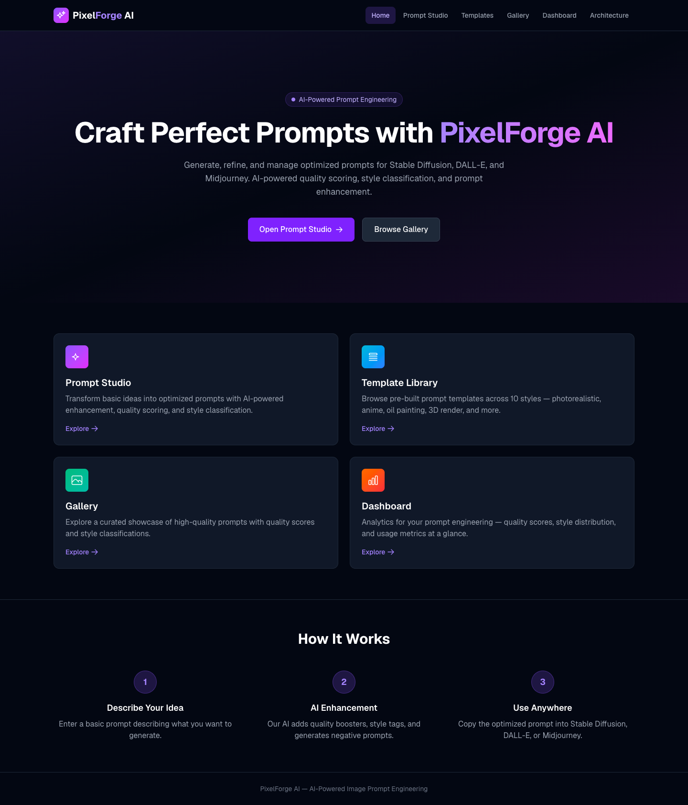
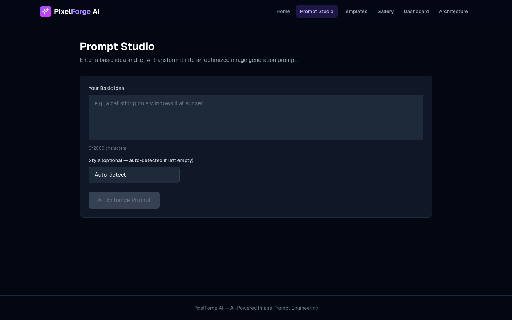
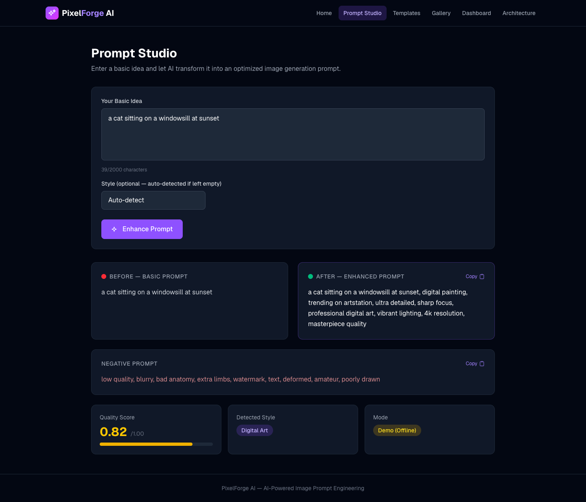
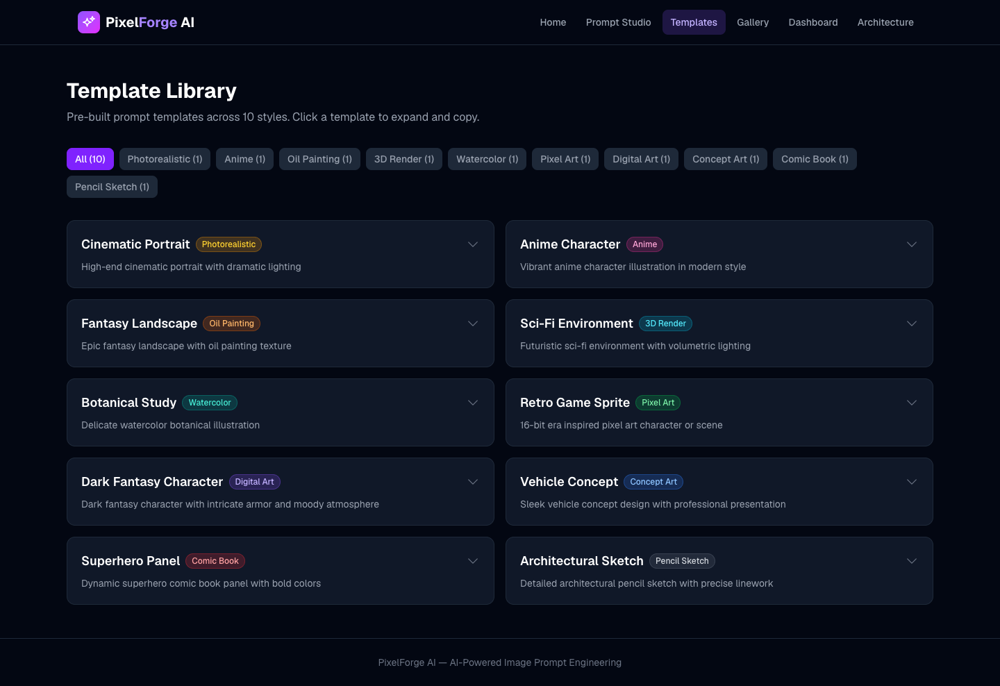
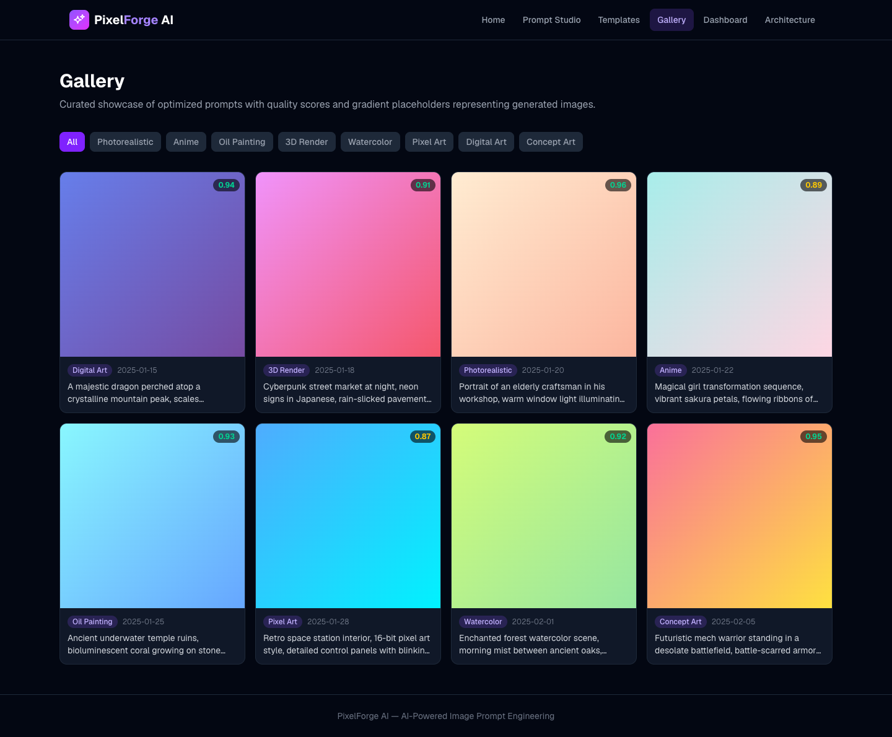
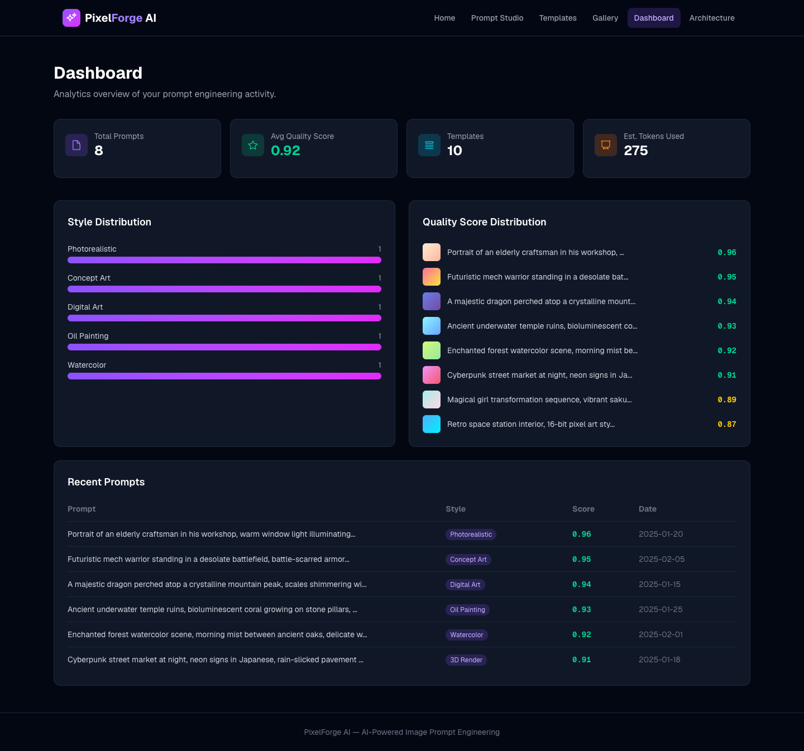
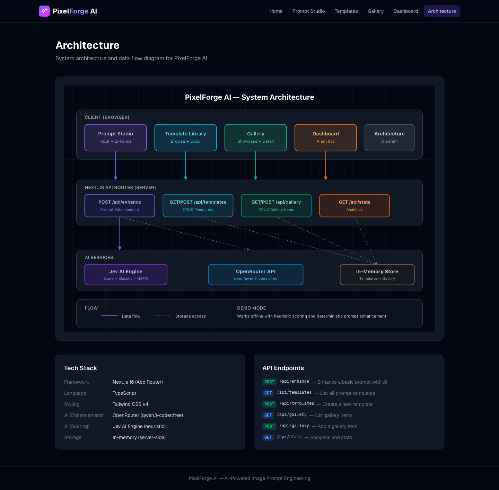

# PixelForge AI — AI Image Prompt Generator & Manager

A full-stack AI-powered tool for creating, refining, and managing optimized image generation prompts for Stable Diffusion, DALL-E, and Midjourney.

## What It Does

PixelForge AI focuses on the **prompt engineering** side of AI image generation. Instead of generating images directly, it helps users craft high-quality prompts that produce better results in any AI image generator.

### Core Features

- **Prompt Studio** — Input a basic idea, and the AI enhances it into a detailed prompt with style-specific quality boosters, generates negative prompts, and scores prompt quality (0-1)
- **Template Library** — 10 pre-built prompt templates across styles: Photorealistic, Anime, Oil Painting, 3D Render, Watercolor, Pixel Art, Digital Art, Concept Art, Comic Book, Pencil Sketch
- **Gallery** — Showcase of 8 curated prompts with gradient placeholder cards, quality scores, and style classifications
- **Dashboard** — Analytics: total prompts, average quality score, style distribution bars, token estimates, recent activity table
- **Architecture Diagram** — Interactive SVG system diagram showing data flow between client, API routes, and AI services

### AI Pipeline

| Layer | Role | Provider |
|-------|------|----------|
| Quality Scoring | Scores prompt quality 0-1 based on detail, keywords, and style specificity | Jev AI (heuristic engine) |
| Style Classification | Classifies prompt into one of 10 visual styles | Jev AI (keyword matching) |
| NSFW Detection | Flags inappropriate content | Jev AI (keyword filter) |
| Prompt Enhancement | Expands basic ideas into detailed, optimized prompts | OpenRouter (qwen3-coder:free) |
| Negative Prompts | Generates "things to avoid" for each style | OpenRouter (qwen3-coder:free) |

### Demo Mode

Works fully offline — when API keys are missing, the system falls back to deterministic enhancement with style-appropriate quality boosters and negative prompts.

## Tech Stack

- **Framework**: Next.js 16 (App Router, Server Components)
- **Language**: TypeScript
- **Styling**: Tailwind CSS v4
- **AI Enhancement**: OpenRouter API (qwen/qwen3-coder:free)
- **AI Scoring**: Jev AI Engine (heuristic-based)
- **Storage**: In-memory (server-side, no database required)

## API Endpoints

| Method | Endpoint | Description |
|--------|----------|-------------|
| POST | `/api/enhance` | Enhance a basic prompt with AI scoring and expansion |
| GET | `/api/templates` | List all prompt templates |
| POST | `/api/templates` | Create a new prompt template |
| GET | `/api/gallery` | List gallery items |
| POST | `/api/gallery` | Add a new gallery item |
| GET | `/api/stats` | Analytics and usage statistics |

## Screenshots

### Home Page


### Prompt Studio


### Enhanced Prompt Result


### Template Library


### Gallery


### Dashboard


### Architecture Diagram


## Setup

```bash
npm install
cp .env.local.example .env.local  # Add your API keys
npm run dev
```

## Environment Variables

```
OPENROUTER_API_KEY=       # OpenRouter API key (optional — demo mode works without it)
OPENROUTER_MODEL=         # Model to use (default: qwen/qwen3-coder:free)
JEV_API_KEY=              # Jev AI API key (optional — heuristic scoring always available)
```
